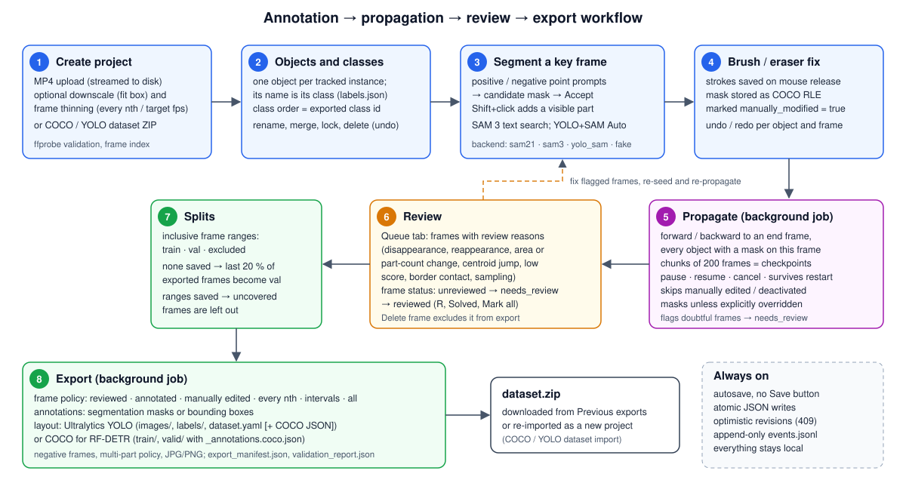

# VISTLabel – Functional Requirements Analysis

**Document purpose:** states what VISTLabel must do (functional requirements), the quality attributes it must have (non-functional requirements), the constraints it works under, and traces every requirement to the implementing modules and to the automated tests that verify it.

| | |
| --- | --- |
| Software | VISTLabel – Video Instance Segmentation, Tracking and Labeling |
| Version | 1.0.0 |
| Source | <https://github.com/It4innovations/VISTLabel> (MIT) |

The requirements below are reconstructed from the released source code, configuration schema (`src/vistlabel/settings.py`), the README and the user guide. Every requirement describes behaviour present in version 1.0.0; nothing here is planned work. Where the code contains configuration keys or directories that are defined but not acted upon, this is stated explicitly in [Constraints and assumptions](#6-constraints-and-assumptions).

---

## 1. Purpose and scope

### 1.1 Purpose

Training an instance-segmentation or object-detection model on video requires pixel masks of each object instance on many frames. Drawing these by hand is slow. VISTLabel is a local, browser-operated tool that lets an annotator:

1. turn a video (or an existing COCO/YOLO image dataset) into a project,
2. outline each object instance on a key frame with model-assisted prompts (SAM 2.1 / SAM 3) and correct the result with a brush and an eraser,
3. let a video segmentation model carry ("propagate") the masks through the remaining frames,
4. review the frames the propagation marks as doubtful, and
5. export a training dataset in the Ultralytics YOLO or COCO (RF-DETR) layout.

### 1.2 Scope

In scope:

- a single-machine web application (FastAPI server + browser UI) storing everything on the local filesystem;
- one video per project; any number of projects per workspace;
- one user account per installation, with browser sessions;
- optional GPU model backends (SAM 2.1, SAM 3, YOLO + SAM) and an always-available deterministic CPU test backend (`fake`).

Out of scope (not implemented in 1.0.0):

- multi-user accounts, roles or per-project permissions;
- a database, a job queue service, or any cloud/remote storage;
- model training; VISTLabel only produces datasets;
- amodal (occluded-extent) masks – only the *visible* part of an object is annotated (`AnnotationMode.MODAL_VISIBLE`);
- HTTPS termination – the server speaks plain HTTP and expects an SSH tunnel or a TLS reverse proxy.

### 1.3 Definitions

| Term | Meaning |
| --- | --- |
| Project | One video (or one stitched image dataset) with its annotations, stored in `workspace/projects/prj_<ULID>/`. |
| Object | One tracked instance (e.g. one pipette), identified by `object_id`, with one class. |
| Class / label | The name an object is exported under (`labels.json`); its position in the class list is the exported class id. |
| Mask | Binary visible-pixel mask of one object on one frame, stored as COCO compressed RLE. |
| Multi-part object | An object whose visible mask has several disconnected components (e.g. a pipette split by a finger). |
| Candidate | A mask returned by a model for prompts; it is not stored until the user accepts it. |
| Propagation run | A background job carrying masks from a start frame to an end frame, persisted as a `TrackingRunManifest`. |
| Review reason | A machine-detected signal (e.g. disappearance, large area change) that flags a frame for human review. |
| Split | Assignment of frame ranges to `train`, `val` or `excluded` for export. |
| Backend | An implementation of the `VideoSegmentationBackend` protocol: `sam21`, `sam3`, `yolo_sam` or `fake`. |

---

## 2. Actors

| Actor | Description | Interacts through |
| --- | --- | --- |
| **Annotator** | Creates projects, segments objects, propagates, reviews and exports. Signs in with the single account. | Browser UI (`/`, `/projects/{id}`, `/help`) |
| **Administrator** | Installs VISTLabel, configures `config/app.yaml`, downloads model checkpoints, creates/changes the account, revokes sessions, runs diagnostics. | Server shell: `vistlabel` CLI, `scripts/*.py`, `python -m vistlabel.diagnostics.*` |
| **API client / script** | Automates the same operations over HTTP after signing in (`POST /api/v1/auth/login` + `X-Requested-With: VISTLabel`). | REST API under `/api/v1` |
| **Monitoring probe** | Checks liveness without credentials. | `GET /api/v1/health`, `GET /api/v1/version` |
| **Model backend** (system actor) | Produces candidate masks, concept proposals and propagated masks. | `VideoSegmentationBackend` protocol |

---

## 3. Use cases

The core workflow connecting the use cases:

| ID | Use case | Primary actor | Main flow (summary) | Related FRs |
| --- | --- | --- | --- | --- |
| UC-01 | Set up the installation | Administrator | Install into a virtual environment, copy `config/app.example.yaml` to `config/app.yaml`, run `vistlabel auth set-password`, start `vistlabel serve`. | FR-AUTH-01..03, FR-SYS-05 |
| UC-02 | Sign in / sign out | Annotator | Open the address, get redirected to `/login`, enter credentials, return to the requested page; **Sign out** ends the session. | FR-AUTH-04..10 |
| UC-03 | Create a project from an MP4 | Annotator | **Create project** → name, MP4 file, optional resolution and frame options → upload with progress → project card appears. | FR-PRJ-01..10 |
| UC-04 | Create a project from a COCO/YOLO ZIP | Annotator | **Create project** → source "COCO or YOLO dataset" → ZIP, format, frame rate, optional thinning → import report. | FR-IMP-01..07 |
| UC-05 | Define objects and classes | Annotator | Type an object name → **+ New**; rename, merge, reorder, lock, delete (with undo). | FR-OBJ-01..10 |
| UC-06 | Segment an object with point prompts | Annotator | Select object → positive/negative clicks → candidate → **Accept candidate**. | FR-SEG-01..06 |
| UC-07 | Find objects by text (SAM 3) | Annotator | Type a description → **Find in this frame** → pick a match → confirm class → **Accept as new object**. | FR-SEG-07..08 |
| UC-08 | Automatic pre-annotation (YOLO + SAM) | Annotator | **Auto** → list of frames → background job creates objects and masks. | FR-SEG-09..10 |
| UC-09 | Correct a mask with brush/eraser | Annotator | Brush or eraser strokes; each stroke is saved on release; undo/redo. | FR-BRU-01..05 |
| UC-10 | Annotate an occluded object | Annotator | Shift+click adds a separate visible part; optionally record the occluder. | FR-OCC-01..05 |
| UC-11 | Propagate masks through the video | Annotator | Choose direction and end frame → **Run** → progress → **Propagation complete**; pause/resume/cancel in **Runs**. | FR-PRP-01..12 |
| UC-12 | Review doubtful frames | Annotator | **Queue** tab → jump to frame → fix → **Solved**; or mark all annotated frames reviewed. | FR-REV-01..07 |
| UC-13 | Assign train/val splits | Annotator | **Splits** tab → add ranges → **Save splits**. | FR-SPL-01..04 |
| UC-14 | Export a dataset | Annotator | **Export** → frames, annotation type, layout, image format, negatives, multi-part policy → **Start export** → **Download ZIP**. | FR-EXP-01..14 |
| UC-15 | Check system status | Annotator / Administrator | **System status** dialog or `GET /api/v1/health`, `/models`, `/metrics`; CLI diagnostics. | FR-SYS-01..06 |
| UC-16 | Recover after a crash or restart | System / Administrator | On start-up, leftover staging directories are removed, running jobs marked failed and running propagation runs marked *interrupted*; the annotator resumes or cancels them explicitly. | FR-PRP-08..09, NFR-05 |

---

## 4. Functional requirements

Priorities: **M** = must (core workflow), **S** = should (supporting function). All listed requirements are implemented in 1.0.0.

### 4.1 Projects and video ingest (FR-PRJ)

| ID | Requirement | Prio |
| --- | --- | --- |
| FR-PRJ-01 | The system shall create a project and upload its MP4 video in one combined `multipart/form-data` request (`POST /api/v1/projects` with `project_name` and `video_file`). There is no separate "attach video" path. | M |
| FR-PRJ-02 | The upload shall be streamed to `source/video.mp4.part` in chunks (`upload.chunk_size_mb`, default 8 MB) while computing its SHA-256, never holding the whole file in memory. | M |
| FR-PRJ-03 | The system shall refuse an upload larger than `upload.maximum_file_size_gb` (default 50 GB) or when the workspace volume has less free space than `upload.minimum_free_disk_space_gb` (default 20 GB). | M |
| FR-PRJ-04 | The video shall be validated with `ffprobe` (decodable video stream, width/height, pixel format, duration, usable frame rate) – the file name, extension and client MIME type are never trusted. | M |
| FR-PRJ-05 | Optionally, the video shall be downscaled to fit inside a maximum width × height, keeping the aspect ratio, rounding to even dimensions and never upscaling (Lanczos scaling). | S |
| FR-PRJ-06 | Optionally, the frame count shall be thinned by keeping every *n*-th frame (frames 0, n, 2n, …) **or** by resampling to a target frame rate that must not exceed the source rate; the two options are mutually exclusive and validated before the project is created. | S |
| FR-PRJ-07 | A variable-frame-rate recording shall be re-timed to a constant rate (`upload.normalized_frame_rate`, default 30, never above the recording's own average rate) when `upload.normalize_variable_frame_rate` is enabled. | S |
| FR-PRJ-08 | All requested transformations shall be applied in a single H.264 re-encode before frame indexing; the original file's properties (size, fps, SHA-256) shall be retained in `project.json` (`source.original`). | S |
| FR-PRJ-09 | The system shall build a deterministic frame index (timestamp per frame) by decoding the whole stream once; the decoded frame count is authoritative. Individual frames and 160-px thumbnails are served as JPEG and cached on disk. | M |
| FR-PRJ-10 | Any failure during upload, validation, re-encode or indexing shall delete the just-created project, so no half-initialised project remains. | M |
| FR-PRJ-11 | The Projects page shall list every project as a card with a first-frame thumbnail, size, frame rate, frame count and progress (annotated and reviewed frames, derived from the frame files on every read), with a name search filter. | M |
| FR-PRJ-12 | The annotator shall be able to set a project status label (`new`, `in_progress`, `done`, `archived`); `pending` is machine-owned (video not yet finalised) and cannot be set through the API. | S |
| FR-PRJ-13 | A project shall be deletable after the user types its name to confirm; deletion closes the project's backend sessions. | S |
| FR-PRJ-14 | The workspace shall remember per project the last opened frame, the selected object and the selected backend (`ui_state`). | S |

### 4.2 COCO / YOLO dataset import (FR-IMP)

| ID | Requirement | Prio |
| --- | --- | --- |
| FR-IMP-01 | The system shall create a project from a ZIP containing a COCO or an Ultralytics/Roboflow YOLO dataset (`POST /api/v1/projects/import-dataset`); format `auto` prefers COCO when both are present. | S |
| FR-IMP-02 | The ZIP shall be read in place, never extracted; oversized text members (> 1 GiB) are refused, so crafted member names or ZIP bombs cannot reach the filesystem. | M |
| FR-IMP-03 | The images shall become the project's frames, one image per frame in natural filename order, encoded into one video at an operator-chosen frame rate in (0, 240]; smaller images are padded at the right/bottom (not scaled) so annotation coordinates stay exact. | S |
| FR-IMP-04 | COCO polygons and (un)compressed RLE, and YOLO polygons, shall be rasterised into canonical RLE masks; box-only annotations become filled rectangles with `source = "import_bbox"` so they can be refined with SAM. | S |
| FR-IMP-05 | Object identity across images shall come from dataset track ids (`track_id`, `instance_id`, CVAT `attributes.track_id`) where present, otherwise from greedy same-class IoU matching between consecutive frames. | S |
| FR-IMP-06 | A dataset with train and val parts shall keep that split as split ranges; **Keep every nth image** thins the dataset. | S |
| FR-IMP-07 | Anything that could not be imported shall be reported to the user after the import; a failed import leaves no project. | S |

### 4.3 Objects and classes (FR-OBJ)

| ID | Requirement | Prio |
| --- | --- | --- |
| FR-OBJ-01 | The annotator shall create an object by typing a name; the name is its class. A new class is registered in `labels.json` on first use (projects start with an empty ontology); existing names are suggested while typing. | M |
| FR-OBJ-02 | A class's `label_id` shall be its stable identity; its *position* in the class list shall be its exported class id, so reordering (↑/↓) renumbers future exports without rewriting any annotation. | M |
| FR-OBJ-03 | Renaming a class shall rename it for all its objects; renaming it to an existing class name offers a merge. | S |
| FR-OBJ-04 | Merging shall move every object (on every frame) of one class into another class. | S |
| FR-OBJ-05 | Deleting a class shall delete all its objects and their masks on every frame after confirmation; a class with a locked object cannot be deleted. | S |
| FR-OBJ-06 | Changing an object's class shall relabel the object on every frame. A class no other object uses leaves the class list. | S |
| FR-OBJ-07 | A locked object shall not be deletable (alone or with its class) until unlocked; editing, hiding and deactivating remain possible. | S |
| FR-OBJ-08 | Deleting an object (or a class) shall be undoable: the record, its masks and occlusion edges on every frame and its class position are kept in `annotations/deleted_objects/` (retention 7 days) and restored by `POST …/objects/restore`. | S |
| FR-OBJ-09 | Per frame, an object shall be deactivatable/activatable: the mask moves to `inactive_objects` (not exported, not rendered, not queued, not overwritten by propagation) and is restored exactly on activation. | M |
| FR-OBJ-10 | Per frame, an object's mask shall be hideable in the view only (still saved and exported). | S |
| FR-OBJ-11 | An optional elongated-axis hint (polyline) shall be storable per object as metadata; it never changes the mask. | S |

### 4.4 Model-assisted segmentation (FR-SEG)

| ID | Requirement | Prio |
| --- | --- | --- |
| FR-SEG-01 | The annotator shall select the segmentation backend in the workspace header. Every backend is always listed; a backend that is disabled, not installed or misconfigured is shown unavailable **with the exact reason** and is never silently replaced by another model. | M |
| FR-SEG-02 | Positive and negative point prompts (and optionally a box) on a frame shall return a **candidate** mask with score and part count (`POST …/segment`). | M |
| FR-SEG-03 | Repeated clicks shall refine the same candidate; **Clear points** discards it. | M |
| FR-SEG-04 | Nothing shall be stored until the annotator accepts the candidate, which saves it as the object's mask on that frame. | M |
| FR-SEG-05 | A backend asked for an operation it does not support shall answer with a typed capability error (HTTP 4xx with reason); UI controls the selected backend cannot serve are disabled with an explanatory tooltip. | M |
| FR-SEG-06 | Backend video sessions shall be reused per (project, backend) and bounded by an LRU cache (`tracking.max_open_backend_sessions`, default 4). | S |
| FR-SEG-07 | With SAM 3, a text description shall return the matching instances on the current frame as proposals (`POST …/segment-concept`), without creating any annotation. | S |
| FR-SEG-08 | A proposal shall become a new object only after the annotator confirms or corrects its class and accepts it. | S |
| FR-SEG-09 | With YOLO + SAM, automatic pre-annotation shall run over a list/range of frames as a cancellable background job and create objects and masks (`POST …/auto-preannotate`). | S |
| FR-SEG-10 | A detection whose class (via the administrator's class-mapping file) is not one of the project's classes shall be skipped, never guessed. | S |

### 4.5 Brush and eraser (FR-BRU)

| ID | Requirement | Prio |
| --- | --- | --- |
| FR-BRU-01 | The annotator shall paint onto (brush) or remove from (eraser, or right-drag with the brush) the selected object's mask with an adjustable radius. | M |
| FR-BRU-02 | Each stroke shall be saved on mouse release (autosave; there is no Save button) through `PATCH …/frames/{i}/annotations` with an optimistic revision; a stale revision is rejected with HTTP 409. | M |
| FR-BRU-03 | Masks shall travel from the browser as lossless PNG (base64), be checked for exact frame size and strictly binary values, and be stored as COCO compressed RLE. | M |
| FR-BRU-04 | A brush- or eraser-edited mask shall be marked `manually_modified = true`. | M |
| FR-BRU-05 | Undo/redo shall revert/re-apply strokes on the same object and frame, and restore deleted objects or classes while the page is open. | S |

### 4.6 Multi-part objects and occlusion (FR-OCC)

| ID | Requirement | Prio |
| --- | --- | --- |
| FR-OCC-01 | One object shall be able to have a visible mask with several disconnected parts and still be one instance. | M |
| FR-OCC-02 | Shift+click with a point tool shall add a separate visible part to the saved mask (the saved mask is sent as `previous_mask_png_base64` and unioned with the new prompt). | M |
| FR-OCC-03 | The occlusion state shall be derived from the mask topology on every save, never set by the client: 0 parts → `fully_occluded`, 1 → `visible`, ≥ 2 → `partially_occluded`. | M |
| FR-OCC-04 | The annotator shall record which object occludes which on a frame (`occlusion_edges`, relation `in_front_of`); this is metadata and changes no mask or export. | S |
| FR-OCC-05 | Export shall handle multi-part masks explicitly (see FR-EXP-07); the canonical mask is never modified. | M |

### 4.7 Propagation runs (FR-PRP)

| ID | Requirement | Prio |
| --- | --- | --- |
| FR-PRP-01 | The annotator shall propagate masks from the current frame **forward** or **backward** to a chosen end frame with the selected backend (`POST …/propagate`, HTTP 202 with `job_id` and `run_id`). The UI submits every object that has a saved mask on the current frame. | M |
| FR-PRP-02 | Propagation shall run as a background job outside the web request, bounded by `runtime.maximum_concurrent_gpu_jobs` (default 1) across all projects. | M |
| FR-PRP-03 | Before starting, the backend session shall be re-seeded from the saved masks on the start frame; a mask that propagation did not produce (hand correction, accepted click) is a fresh seed – the backend first forgets the object. | M |
| FR-PRP-04 | The range shall be processed in chunks of `tracking.default_chunk_frames` frames (default 200; overridable per request). Consecutive chunks share their boundary frame. | M |
| FR-PRP-05 | After each fully processed chunk, the run manifest shall record `last_completed_frame` (the checkpoint). A crash mid-chunk re-does only that chunk. | M |
| FR-PRP-06 | **Pause** shall stop the run at the next chunk boundary (status `paused`); **Resume** shall start a new job attempt from `last_completed_frame`, re-seeding from the saved masks there. | M |
| FR-PRP-07 | **Cancel** of a running job shall stop it (status `cancelled`); frames already written are kept. A paused or interrupted run can be abandoned explicitly (`…/tracking-runs/{id}/cancel`). | M |
| FR-PRP-08 | On start-up, a run still marked `running` shall be marked `interrupted` and job records still `pending`/`running` marked `failed` ("interrupted by process restart"); interrupted runs are **never resumed automatically**. | M |
| FR-PRP-09 | Propagation shall **never overwrite** a mask marked `manually_modified` or an object deactivated on that frame, unless the request explicitly sets `overwrite_manual_masks: true`; the number of protected masks is recorded in the manifest. | M |
| FR-PRP-10 | Each propagated mask shall carry its source (`<backend>_propagation`), confidence and machine review reasons; a frame with any reason that is still `unreviewed` becomes `needs_review`. | M |
| FR-PRP-11 | Review reasons shall include low model score (< 0.5), mask touching the frame border, disappearance/complete occlusion, reappearance, part-count change, area change ≥ 50 %, centroid jump ≥ 10 % of the frame diagonal, and optional periodic sampling every `tracking.review_sampling_stride` frames. | M |
| FR-PRP-12 | The UI shall show progress, list all runs of a project (also from other browsers or before a restart) in **Runs**, and optionally play a sound and show a browser notification when a run finishes, fails or pauses. | S |

### 4.8 Review queue and frame status (FR-REV)

| ID | Requirement | Prio |
| --- | --- | --- |
| FR-REV-01 | Every frame shall have a review status `unreviewed`, `needs_review` or `reviewed`, and an optional review comment. | M |
| FR-REV-02 | The annotator shall set the status from the action bar, the Review tab or the <kbd>R</kbd> shortcut (reviewed). | M |
| FR-REV-03 | The review queue (`GET …/review-queue`) shall list flagged frames with object, reasons and comment; selecting an entry jumps to the frame and selects the object. | M |
| FR-REV-04 | **Solved** shall mark the frame reviewed and remove it from the queue. | M |
| FR-REV-05 | **Mark all annotated frames reviewed** shall first report how many frames (and how many queued) would change (dry run), and change them only after confirmation. | S |
| FR-REV-06 | **Delete frame** shall exclude a frame from every export and from the queue while keeping the video frame and its masks; **Restore frame** reverts it losslessly. | S |
| FR-REV-07 | A frame is "annotated" when it is not deleted and has at least one non-empty mask; this single definition drives the progress count, the "annotated" export policy and "mark all reviewed". | M |

### 4.9 Splits (FR-SPL)

| ID | Requirement | Prio |
| --- | --- | --- |
| FR-SPL-01 | The annotator shall assign inclusive frame ranges to `train`, `val` or `excluded` and save them with the project. | M |
| FR-SPL-02 | With no ranges saved, an export shall put the last 20 % of the exported frames (in frame order, at least one) into `val` and the rest into `train` – a contiguous block, not a random split. | M |
| FR-SPL-03 | Once any range is saved, only frames covered by a `train` or `val` range shall be exported; uncovered or `excluded` frames are left out and counted in the export report. | M |
| FR-SPL-04 | The export report shall warn when two neighbouring frames land in different splits (leakage risk). | S |

### 4.10 Export (FR-EXP)

| ID | Requirement | Prio |
| --- | --- | --- |
| FR-EXP-01 | Export shall run as a background job (`POST …/exports`, HTTP 202) with progress and cancellation. | M |
| FR-EXP-02 | Frame selection policies: reviewed only; all annotated; manually edited only; every *n*-th reviewed; every *n*-th annotated; selected intervals; every frame with annotation data. | M |
| FR-EXP-03 | The "every frame" policy shall require explicit acknowledgement (`acknowledge_all_frames_warning`), otherwise the request is rejected. | S |
| FR-EXP-04 | Deleted frames, deactivated objects and masks of objects that no longer exist shall never be exported; the report says how many were left out. | M |
| FR-EXP-05 | Annotation type: segmentation (YOLO polygon / COCO RLE) or bounding box (tight box around all parts of the mask). | M |
| FR-EXP-06 | Dataset layout: Ultralytics YOLO (`images/{train,val}`, `labels/{train,val}`, `dataset.yaml`, optionally `annotations/instances_{train,val}.json`) or COCO for RF-DETR (`train/` and `valid/`, each with `_annotations.coco.json`). | M |
| FR-EXP-07 | YOLO multi-part policy: `strict_error` (drop the instance from YOLO, keep it in COCO), `minimal_bridge` (connect parts by minimal 1-px lines into one outline) or `split_components` (one row per part). COCO always keeps the exact mask. | M |
| FR-EXP-08 | Exported class ids shall be the dense positions 0..N-1 of the classes in `labels.json`. | M |
| FR-EXP-09 | Image format JPG (quality `export.jpeg_quality`, default 95) or PNG. | S |
| FR-EXP-10 | A fraction of never-annotated frames shall be addable as negatives with empty labels, sampled at an even stride across the video. | S |
| FR-EXP-11 | Each export shall write `export_manifest.json` (settings, counts, status) and `validation_report.json` (image count, objects per class, multi-part conversions, dropped instances, invalid polygons, tiny masks, missing files, duplicate annotations, leakage risks, model provenance summary, warnings, errors), and package everything as `dataset.zip`. | M |
| FR-EXP-12 | Previous exports shall be listable with their settings, downloadable as ZIP and deletable (`GET/DELETE …/exports/{id}`, `…/download`, `…/validation-report`). | S |
| FR-EXP-13 | "Project default" options shall resolve to the `export.*` configuration values. | S |
| FR-EXP-14 | An export selecting zero frames shall still succeed with an empty but well-formed dataset. | S |

### 4.11 Authentication and sessions (FR-AUTH)

| ID | Requirement | Prio |
| --- | --- | --- |
| FR-AUTH-01 | There shall be exactly one account, created and changed only on the server with `vistlabel auth set-password --username <name>` (prompted twice, or from `VISTLABEL_PASSWORD` without a terminal); there is no web registration. | M |
| FR-AUTH-02 | Passwords shall have at least 8 characters and no leading/trailing whitespace; user names 1–64 characters of letters, digits and `. _ @ -`. | M |
| FR-AUTH-03 | The password shall be stored only as an Argon2id hash (`workspace/auth/account.json`); it is never read from the configuration file and never logged. | M |
| FR-AUTH-04 | Every page and API call shall require a signed-in session, except `/login`, `/setup`, `/api/v1/health`, `/api/v1/version`, `/api/v1/auth/login`, `/api/v1/auth/status` and `/static/*`. API calls without a session get HTTP 401; pages redirect to `/login?next=…` (or `/setup` while no account exists). | M |
| FR-AUTH-05 | After sign-in the browser shall return to the originally requested page; the `next` target never leaves the site. | S |
| FR-AUTH-06 | Sessions shall be server-side (only a SHA-256 of the random token is stored in `auth/sessions.json`), survive a server restart, and expire after `security.session_timeout_minutes` (default 120) of inactivity (sliding). | M |
| FR-AUTH-07 | The session cookie `vistlabel_session` shall be `HttpOnly`, `SameSite=Lax`, and `Secure` when `security.secure_cookies` is enabled. | M |
| FR-AUTH-08 | Every state-changing API request (POST/PUT/PATCH/DELETE) shall carry `X-Requested-With: VISTLabel` and, when the browser sends `Origin`, `Sec-Fetch-Site` or `Referer`, be same-origin; otherwise HTTP 403 `CSRF_REJECTED`. | M |
| FR-AUTH-09 | Failed sign-ins shall be rate limited per client address (`security.login_rate_limit`, default 10 within `login_rate_window_seconds`, default 300 s); further attempts get HTTP 429 with `Retry-After`. | M |
| FR-AUTH-10 | **Sign out** shall revoke the session; `vistlabel auth revoke-sessions` signs out every session; `set-password` also revokes all sessions; `vistlabel auth status` shows the account and active session count. | M |

### 4.12 System status, diagnostics and help (FR-SYS)

| ID | Requirement | Prio |
| --- | --- | --- |
| FR-SYS-01 | `GET /api/v1/health` shall report the workspace (writable), FFmpeg, Python and CUDA checks with an overall status (`ok`/`degraded`/`missing`/`error`) and the package version. | M |
| FR-SYS-02 | `GET /api/v1/models` shall list every backend with capabilities, availability, unavailability reason, model name, checkpoint SHA-256 and code revision. | M |
| FR-SYS-03 | `GET /api/v1/metrics` shall return uptime, project count, annotated frame total, jobs by status and backend availability as JSON. | S |
| FR-SYS-04 | The **System status** dialog shall show the same information in the browser. | S |
| FR-SYS-05 | Command-line diagnostics: `python -m vistlabel.diagnostics.system` (health JSON) and `python -m vistlabel.diagnostics.models --backend <id>` (load + minimal image and video inference; exit 0 usable, 1 unavailable with reason). | S |
| FR-SYS-06 | The version shall be defined once (`pyproject.toml`) and reported by `vistlabel version`, `vistlabel --version`, `/api/v1/version`, `/api/v1/health` and the System status dialog. | S |
| FR-SYS-07 | `/help` shall serve the user guide (rendered locally from `docs/user-guide.md`, HTML-escaped, with its screenshots from `docs/images/`), including the keyboard-shortcut table generated from one registry (`static/help/shortcuts.json`); no Help text is shown twice. | S |
| FR-SYS-08 | The UI shall offer a dark and a light theme, remembered by the browser. | S |

---

## 5. Non-functional requirements

| ID | Category | Requirement | How it is met (1.0.0) |
| --- | --- | --- | --- |
| NFR-01 | Offline operation | The application shall not need network access at runtime. | All JS/CSS/fonts are served from `src/vistlabel/static`; no CDN. Models are never downloaded at start-up or request time; `scripts/download_models.py` fetches them explicitly at pinned Hugging Face revisions. |
| NFR-02 | Platforms | Python 3.11–3.13 on Windows, Linux and macOS; Chrome or Firefox. | `requires-python = ">=3.11"`; README: verified on 3.12 and 3.13, macOS with the `fake` backend only. This verification: Windows 11, Python 3.13.13, Chromium and Firefox (see [verification.md](verification.md)). |
| NFR-03 | GPU | Real model backends shall be optional; without an NVIDIA GPU/CUDA PyTorch everything except those backends shall work. | `gpu` extra (torch, torchvision, transformers, huggingface_hub, accelerate, ultralytics); `float16` default dtype (`bfloat16` optional); at most `runtime.maximum_concurrent_gpu_jobs` GPU jobs; SAM 3 keeps only one of its two models in GPU memory; job failures call `torch.cuda.empty_cache()`. |
| NFR-04 | Disk space | Uploads shall be refused below a free-space floor; caches shall be disposable. | 20 GB floor and 50 GB maximum upload (configurable); `cache/` may be deleted at any time and is rebuilt on demand. |
| NFR-05 | Data integrity | No partially written authoritative file; concurrent edits detected; crashes recoverable. | Atomic writes (temp file in same directory, flush, fsync, `os.replace`, Windows retries); optimistic `revision` on project, objects and frame files (HTTP 409); project creation via staging directory + atomic rename; start-up recovery of staging dirs, jobs and runs; append-only `logs/events.jsonl`; lossless RLE masks. |
| NFR-06 | Schema evolution | Stored documents shall be versioned and migratable. | Every document has `schema_version`; `persistence.migrations` refuses newer versions and applies registered migrations step by step (none needed at 1.0.0). |
| NFR-07 | Security | Protect against unauthenticated access, CSRF, brute force, path traversal and markup injection. | See FR-AUTH; server-generated project ids validated against `^prj_[0-9A-HJKMNP-TV-Z]{26}$`; `is_safe_child_path` before every `rmtree`; ZIPs never extracted; help Markdown HTML-escaped; default bind `127.0.0.1`; plain HTTP behind SSH tunnel or TLS proxy. |
| NFR-08 | Provenance | Model-generated annotations shall be traceable. | `backend_provenance` (backend, model name, checkpoint SHA-256, code revision, operation id) on accepted model masks; `source` and `confidence` per mask; provenance summary in every validation report. |
| NFR-09 | Responsiveness | Model inference and video decoding shall not block the web server. | Long work in `JobManager` threads; upload finalisation in `asyncio.to_thread`; job progress writes throttled to every 0.5 s. |
| NFR-10 | Licensing | Source under MIT; third-party models not redistributed. | `LICENSE` (MIT, © 2026 IT4Innovations, VSB-TUO); SPDX headers in all 176 Python, 8 JS, 2 CSS and 11 HTML files; checkpoints git-ignored; Ultralytics (AGPL-3.0) imported only by the optional `yolo_sam` backend; IT4I logo excluded from MIT. |
| NFR-11 | Maintainability | Code shall pass static checks and an automated test suite. | `ruff` (E, F, I, UP, B), `mypy` with `disallow_untyped_defs`, pytest suite of 505 tests in unit, integration, model-contract and browser layers. |
| NFR-12 | Usability | Keyboard-driven annotation, layout-independent shortcuts, help in the app. | Shortcut registry with 20 entries; number keys by physical key (work on Czech layout); in-app user guide. |

---

## 6. Constraints and assumptions

1. **One video per project, one editor per project.** The data model has exactly one `source/video.mp4` per project. An advisory editor lock (`persistence/locks.py`, `ProjectStore.lock_for`) exists, but the HTTP API does not acquire it in 1.0.0; protection against concurrent edits relies on optimistic revisions (HTTP 409).
2. **Single account.** All signed-in users act as the same account; there are no roles.
3. **Filesystem scale.** The review queue, progress counts and exports scan all frame files of a project (no index). The upload-time frame index requires one full decode pass; the README notes this does not scale to tens-of-GB uploads without further work.
4. **FFmpeg is an external prerequisite** (`ffmpeg` and `ffprobe` on `PATH` or in `runtime.ffmpeg_dir`). PyAV is used for decoding.
5. **Model checkpoints are supplied by the administrator** and are subject to their own licences (SAM 2.1: Apache-2.0; SAM 3: Meta SAM License, gated; YOLO: the administrator's own trained checkpoint – a generic pretrained YOLO is never loaded).
6. **SAM 3, not SAM 3.1.** The `sam3` backend runs `facebook/sam3` via `transformers`, because SAM 3.1 has no transformers integration.
7. **Plain HTTP.** Deployments beyond localhost need an SSH tunnel or a TLS reverse proxy with `security.secure_cookies: true`.
8. **Configuration keys without effect in 1.0.0.** `upload.allowed_extensions`, `tracking.checkpoint_after_chunk`, `models.sam3.require_startup_diagnostic` and `models.yolo_sam.detection_stride_frames` are defined in the settings schema but not referenced by the application code (checkpointing after each chunk always happens; the file picker filters `.mp4`, and the server validates content with ffprobe instead of the extension). The project directories `prompts/frames`, `tracking/checkpoints` and `cache/model_sessions` are created but not written to.
9. **The `fake` backend is a test double**, not an annotation model: a point prompt yields a 4-px-radius disk, and propagation shifts the mask 2 px per frame.

---

## 7. Traceability matrix

Module paths are relative to `src/vistlabel/`; test paths relative to `tests/`. "B" marks Playwright browser tests, "G" GPU tests that require real checkpoints.

| Requirement(s) | Implementing module(s) | Verifying test(s) |
| --- | --- | --- |
| FR-PRJ-01, -10 | `api/projects.py` (`create_project`), `projects/store.py` | `integration/test_projects_api.py` (`test_create_list_get_delete_project`, `test_create_project_with_invalid_video_is_rejected_and_leaves_no_project`), B `browser/test_upload.py` |
| FR-PRJ-02, -03 | `video/upload.py` (`save_upload_streaming`) | `unit/test_video_upload.py` |
| FR-PRJ-04 | `video/validation.py`, `video/ffmpeg.py` | `unit/test_video_validation.py`, `unit/test_video_ffmpeg_discovery.py` |
| FR-PRJ-05..08 | `video/upload.py` (`plan_transcode`, `transcode_video`), `domain/project.py` (`VideoImportOptions`) | `unit/test_video_upload.py`, `integration/test_projects_api.py` (`test_create_project_applies_import_options`, `…_with_invalid_import_options_leaves_no_project`), B `browser/test_upload.py::test_import_options_downscale_and_thin_frames` |
| FR-PRJ-09 | `video/frames.py`, `api/projects.py` (`get_frame`, `get_frame_thumbnail`) | `unit/test_video_frames.py`, `integration/test_projects_api.py` (`test_get_frame_*`) |
| FR-PRJ-11, -12, -14 | `projects/store.py`, `annotations/frames_service.py` (`count_frame_progress`), `api/projects.py` (`patch_project`), `templates/index.html` | `integration/test_project_progress.py`, `integration/test_projects_api.py` (`test_status_*`), `integration/test_project_store.py` |
| FR-PRJ-13 | `projects/store.py` (`delete`), `persistence/safety.py`, `segmentation/sessions.py` | `integration/test_security_path_traversal.py`, `unit/test_path_traversal_safety.py` |
| FR-IMP-01..07 | `api/dataset_imports.py`, `imports/archive.py`, `imports/coco_reader.py`, `imports/yolo_reader.py`, `imports/service.py` | `unit/test_dataset_import.py`, `integration/test_dataset_import_api.py` |
| FR-OBJ-01..07, -11 | `api/objects.py`, `api/projects.py` (labels), `annotations/objects_service.py`, `domain/labels.py`, `domain/objects.py` | `integration/test_class_operations_api.py`, `integration/test_annotation_workflow.py` (`test_object_lifecycle_*`, `test_locked_object_*`, `test_a_class_leaves_the_list_with_its_last_object`), `integration/test_multipart_and_review.py::test_geometry_hint_*`, B `browser/test_annotation.py` |
| FR-OBJ-08 | `annotations/objects_service.py` (`delete_object`, `restore_objects`) | `integration/test_class_operations_api.py` (`test_restore_*`) |
| FR-OBJ-09, -10 | `api/frame_annotations.py` (`deactivate_object_id`, `activate_object_id`), `static/js/annotation-canvas.js` | `integration/test_tracking_runs_api.py::test_object_inactive_on_a_frame_stays_inactive_through_propagation`, B `browser/test_hide_on_frame.py` |
| FR-SEG-01, -05 | `segmentation/registry.py`, `segmentation/base.py`, `segmentation/_stub.py`, `api/health.py` | `unit/test_stub_backends.py`, `unit/test_sam21_backend_config.py`, `unit/test_sam3_backend_config.py`, `integration/test_annotation_workflow.py` (`test_segment_with_unknown_backend_returns_404`, `…unavailable_backend_returns_409`) |
| FR-SEG-02..04 | `api/segmentation.py` (`segment`), `segmentation/fake.py`, `segmentation/sam21.py`, `segmentation/sam3.py` | `integration/test_annotation_workflow.py::test_segment_produces_a_mask_that_can_be_saved_and_read_back`, `model_contract/test_fake_backend_contract.py`, G `model_contract/test_sam21_backend_contract.py`, B `browser/test_annotation.py` |
| FR-SEG-06 | `segmentation/sessions.py` | `integration/test_propagation_api.py` (re-seed tests), `integration/test_tracking_stress.py` |
| FR-SEG-07, -08 | `api/segmentation.py` (`segment_concept`), `segmentation/sam3.py`, `static/js/concept-search.js` | `integration/test_concept_segmentation_api.py`, B `browser/test_concept_search.py` |
| FR-SEG-09, -10 | `api/auto_preannotate.py`, `segmentation/yolo_sam.py`, `segmentation/yolo_detector.py`, `segmentation/yolo_class_mapping.py` | `integration/test_auto_preannotate_api.py`, `unit/test_yolo_sam_orchestration.py`, `unit/test_yolo_class_mapping.py`, G `model_contract/test_yolo_sam_real.py` |
| FR-BRU-01..05 | `api/frame_annotations.py` (`patch_frame_annotations`), `annotations/png_mask.py`, `annotations/frames_service.py`, `persistence/rle.py`, `static/js/annotation-canvas.js` | `unit/test_png_mask.py`, `unit/test_rle.py`, `unit/test_frames_service.py`, `integration/test_annotation_workflow.py` (`test_patch_frame_annotation_with_stale_revision_conflicts`, `…_rejects_malformed_mask`), B `browser/test_annotation.py` (`test_brush_edit_autosaves_and_undo_reverts`, `test_right_drag_with_the_brush_erases`) |
| FR-OCC-01..04 | `annotations/occlusion.py`, `api/segmentation.py` (`previous_mask_png_base64`), `api/frame_annotations.py` (`occlusion_edges`), `persistence/rle.py` (`count_connected_components`) | `unit/test_occlusion.py`, `integration/test_multipart_and_review.py`, `integration/test_pipette_occlusion_fixture.py`, B `browser/test_multipart_and_review.py`, G `model_contract/test_sam21_pipette_occlusion.py` |
| FR-OCC-05, FR-EXP-07 | `exports/yolo_writer.py`, `exports/polygon.py` | `unit/test_yolo_writer.py`, `unit/test_export_polygon.py`, `integration/test_exports_api.py` (`test_export_minimal_bridge_*`, `test_export_strict_error_*`, `test_export_split_components_*`) |
| FR-PRP-01..05 | `api/propagation.py` (`start_propagation`, `_chunk_ranges`, `_run_chunked_propagation`), `jobs/manager.py`, `tracking/manifests.py` | `unit/test_chunk_ranges.py`, `unit/test_job_manager.py`, `unit/test_tracking_manifests.py`, `integration/test_propagation_api.py`, `integration/test_tracking_runs_api.py::test_propagate_completes_in_multiple_chunks_and_manifest_reflects_it`, B `browser/test_propagation.py` |
| FR-PRP-06..08 | `api/propagation.py` (pause/resume/cancel), `jobs/manager.py` (`recover_interrupted_jobs`), `tracking/manifests.py` (`recover_interrupted_runs`), `projects/store.py` | `integration/test_tracking_runs_api.py` (`test_resume_continues_from_last_completed_frame`, `test_cancel_of_interrupted_run_is_a_rollback`, `test_startup_recovery_marks_orphaned_running_manifest_interrupted`, `test_resume_of_a_running_run_is_rejected`), `integration/test_tracking_stress.py` |
| FR-PRP-09 | `api/propagation.py` (`_run_chunked_propagation`) | `integration/test_tracking_runs_api.py` (`test_manual_mask_is_protected_from_propagation_overwrite`, `test_manual_mask_overwritten_when_explicitly_requested`, `test_object_inactive_on_a_frame_stays_inactive_through_propagation`) |
| FR-PRP-10, -11 | `annotations/occlusion.py`, `api/propagation.py` | `unit/test_occlusion.py`, `integration/test_multipart_and_review.py::test_propagation_detects_component_count_change_across_frames` |
| FR-PRP-12 | `templates/_tracking_runs_dialog.html`, `static/js/workspace-panels.js`, `static/js/annotation-canvas.js` | B `browser/test_propagation.py` (`test_finished_propagation_chimes_and_notifies_when_the_tab_is_unfocused`) |
| FR-REV-01..05, -07 | `api/frame_annotations.py` (`mark_annotated_frames_reviewed`), `api/review_queue.py`, `domain/frames.py` | `integration/test_tracking_runs_api.py` (`test_review_queue_*`), `integration/test_project_progress.py`, `unit/test_frame_annotation_model.py`, B `browser/test_hide_on_frame.py`, B `browser/test_multipart_and_review.py` |
| FR-REV-06 | `api/frame_annotations.py` (`excluded`), `exports/service.py` | `integration/test_exports_api.py::test_deleted_frames_are_left_out_of_the_export`, B `browser/test_hide_on_frame.py` |
| FR-SPL-01..04 | `api/projects.py` (`put_split_assignments`), `exports/frame_selection.py` (`assign_splits`, `detect_adjacent_split_leakage`) | `unit/test_frame_selection.py`, `integration/test_exports_api.py::test_split_assignments_control_train_val_and_exclude_frames` |
| FR-EXP-01..06, -08..14 | `api/exports.py`, `exports/service.py`, `exports/frame_selection.py`, `exports/coco_writer.py`, `exports/yolo_writer.py`, `validation/engine.py` | `unit/test_coco_writer.py`, `unit/test_yolo_writer.py`, `unit/test_frame_selection.py`, `unit/test_validation_engine.py`, `integration/test_exports_api.py` (14 tests), B `browser/test_export_and_boxes.py` |
| FR-AUTH-01..03, -10 | `main.py` (CLI), `auth/account.py`, `auth/passwords.py`, `auth/sessions.py` | `unit/test_auth.py`, `integration/test_auth_api.py` (`test_cli_set_password_status_and_revoke`, `test_password_never_appears_in_logs`) |
| FR-AUTH-04..09 | `auth/middleware.py`, `api/auth.py`, `api/pages.py`, `auth/sessions.py` (`LoginRateLimiter`) | `integration/test_auth_api.py` (`test_unauthenticated_api_is_rejected_and_pages_redirect`, `test_login_sets_httponly_cookie_and_logout_clears_it`, `test_login_page_never_redirects_off_site`, `test_secure_cookie_behind_https`, `test_invalid_credentials_and_rate_limit`, `test_csrf_header_is_required_for_state_changes`, `test_no_account_configured_redirects_to_setup`, `test_session_survives_process_restart`), B `browser/test_smoke.py` |
| FR-SYS-01..06 | `api/health.py`, `diagnostics/system.py`, `diagnostics/models.py`, `templates/_metrics_dialog.html` | `integration/test_api.py` (`test_health_*`, `test_version_*`, `test_models_*`, `test_metrics_*`), `integration/test_auth_api.py::test_cli_version`, `unit/test_settings.py` |
| FR-SYS-07, -08 | `api/help.py`, `help/markdown.py`, `help/shortcuts.py`, `static/js/theme.js` | `unit/test_help.py`, `integration/test_help_pages.py`, B `browser/test_help.py` |
| NFR-05, NFR-06 | `persistence/atomic.py`, `persistence/migrations.py`, `persistence/locks.py`, `persistence/jsonl.py`, `projects/store.py` | `unit/test_atomic_writes.py`, `unit/test_migrations.py`, `unit/test_project_lock.py`, `unit/test_jsonl.py`, `integration/test_project_store.py` |
| NFR-07 | `persistence/safety.py`, `projects/ids.py`, `projects/sanitize.py`, `imports/archive.py`, `help/markdown.py` | `unit/test_path_traversal_safety.py`, `unit/test_project_ids.py`, `unit/test_sanitize_project_name.py`, `integration/test_security_path_traversal.py`, `unit/test_help.py` |
| NFR-08 | `segmentation/checkpoints.py`, `domain/frames.py` (`BackendProvenance`) | `unit/test_checkpoint_hashing.py` |
