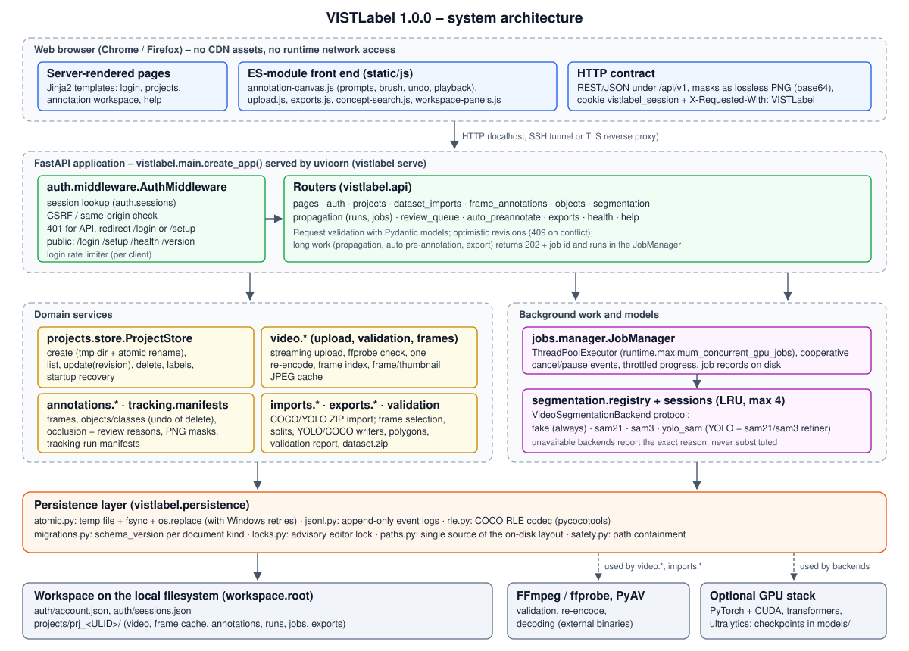
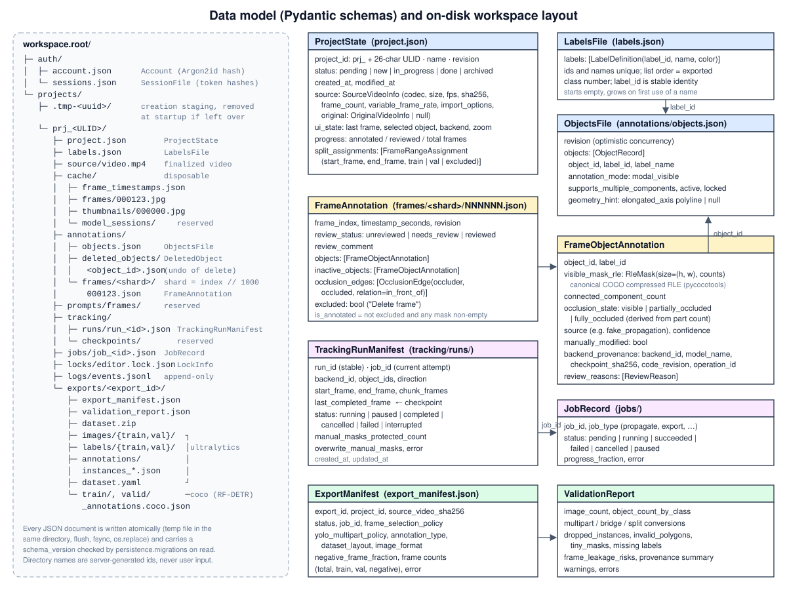
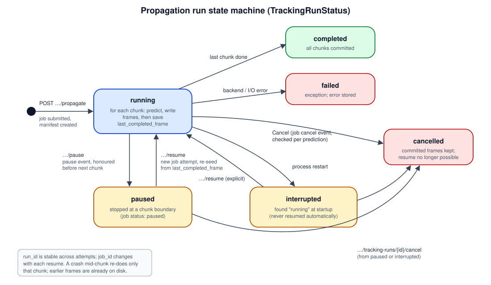

# VISTLabel – Technical Documentation

**Document purpose:** describes the design and working principles of VISTLabel 1.0.0 – architecture, modules, data model and on-disk format, REST API, model backend interface, propagation algorithm, export formats, configuration, security design and the rationale behind the main design decisions.

| | |
| --- | --- |
| Software | VISTLabel – Video Instance Segmentation, Tracking and Labeling |
| Version | 1.0.0 |
| Source | <https://github.com/It4innovations/VISTLabel> |

All statements refer to the released source code in `src/vistlabel/` (paths below are relative to it unless stated otherwise). Requirement identifiers (FR-…, NFR-…) refer to [functional-requirements.md](functional-requirements.md).

---

## 1. Overview

VISTLabel is a single-process Python web application. A FastAPI server, started with `vistlabel serve`, renders a few HTML pages and exposes a JSON REST API under `/api/v1`; the browser front end is plain ES-module JavaScript served from the same process. All persistent state lives in files under one workspace directory. Model inference (SAM 2.1, SAM 3, YOLO + SAM) is pluggable behind one Python protocol and is optional; a deterministic CPU backend (`fake`) is always present.

| Component | Technology | Size (1.0.0) |
| --- | --- | --- |
| Server | Python ≥ 3.11, FastAPI, Starlette, Uvicorn, Pydantic v2, pydantic-settings | 93 Python modules, 12 388 lines |
| Front end | Jinja2 templates, vanilla ES modules, CSS (no framework, no CDN) | 11 templates, 8 JS modules (4 189 lines), 2 CSS files |
| Video | FFmpeg / ffprobe (external binaries), PyAV, OpenCV (headless), Pillow | – |
| Masks | NumPy, pycocotools (COCO RLE), OpenCV contours | – |
| Auth | argon2-cffi (Argon2id) | – |
| Models (optional `gpu` extra) | PyTorch, torchvision, transformers, huggingface_hub, accelerate, ultralytics | – |
| Tests | pytest, pytest-playwright (Chromium, Firefox), httpx | 78 files, 11 096 lines, 505 tests |

---

## 2. Architecture



### 2.1 Layers

1. **Browser UI.** Server-rendered pages (`templates/index.html` – projects, `annotation.html` – workspace, `help.html`, `login.html`, `setup_required.html`) load ES modules from `/static/js`. `annotation-canvas.js` draws the frame, masks, prompts and brush on `<canvas>` layers and owns the undo/redo stacks; `workspace-panels.js` drives the Review, Queue and Splits tabs and the propagation-runs dialog; `upload.js` the create-project dialog with upload progress (XHR) and the project cards; `exports.js` the export dialog; `concept-search.js` the SAM 3 text search; `session.js` wraps `fetch` (adds the CSRF header and handles an expired session); `theme.js` the dark/light theme.
2. **HTTP layer.** `main.create_app()` builds the FastAPI application, attaches `AuthMiddleware`, mounts `/static` and includes 13 routers (`api/*.py`). Routers validate input with Pydantic models and translate domain errors to HTTP codes (404 unknown, 409 revision conflict / unavailable backend / no video, 422 invalid input, 503 FFmpeg missing).
3. **Domain services.** Project store, video ingest, annotation services (frames, objects/classes, occlusion and review reasons, PNG mask exchange), dataset import, export, validation and tracking-run manifests. They operate on Pydantic models and the filesystem only; none of them depends on FastAPI.
4. **Background work and models.** `jobs.manager.JobManager` runs propagation, automatic pre-annotation and export in a `ThreadPoolExecutor`; `segmentation.registry` holds the four backends; `segmentation.sessions.BackendSessionManager` caches open video sessions.
5. **Persistence.** `persistence/` provides atomic JSON writes, append-only JSONL logs, the RLE codec, schema migrations, the advisory lock, path-containment checks and – in `paths.py` – the single definition of the on-disk layout.

### 2.2 Application state

`create_app()` (see [programmer-documentation.md, excerpt 1](programmer-documentation.md#excerpt-1--application-factory)) creates one instance each of: `AppSettings`, `BackendRegistry`, `AccountStore`, `SessionStore`, `LoginRateLimiter`, `ProjectStore`, `BackendSessionManager` and `JobManager`, and stores them on `app.state`. During construction it runs three recovery steps: removing leftover project staging directories, marking running propagation runs `interrupted`, and marking pending/running job records `failed`.

### 2.3 Concurrency model

- Request handlers are mostly synchronous FastAPI endpoints (executed in Starlette's thread pool); the upload endpoints are `async` and stream the body, then call `finalize_video` / `import_dataset` through `asyncio.to_thread`.
- Long-running work is submitted to `JobManager`, whose executor has `runtime.maximum_concurrent_gpu_jobs` workers (default 1) – the global limit across projects. Cancellation and pause are cooperative (`threading.Event`s checked by the work function).
- Concurrent writes by humans are detected with optimistic revisions (`revision` in `project.json`, `objects.json` and each frame file; mismatch → HTTP 409). The propagation job writes frames with `apply_frame_annotation`, which increments the revision without checking it, because the job is the sole automated writer of its range.

---

## 3. Module map

| Package / module | Responsibility |
| --- | --- |
| `main.py` | `create_app()` application factory; `vistlabel` CLI (`serve`, `version`, `auth set-password|status|revoke-sessions`). |
| `settings.py` | `AppSettings` (pydantic-settings): YAML file + `VISTLABEL_<SECTION>__<KEY>` environment overrides; rejects the removed `auth` section and the renamed `models.sam31` key. |
| `logging_config.py` | JSON log formatter (stdlib only). |
| `auth/` | `account.py` single account (Argon2id hash); `passwords.py` hashing and strength rules; `sessions.py` server-side sessions and `LoginRateLimiter`; `middleware.py` `AuthMiddleware` (session + CSRF/same-origin). |
| `api/` | Routers: `auth`, `pages`, `projects`, `dataset_imports`, `frame_annotations`, `objects`, `segmentation`, `propagation`, `review_queue`, `auto_preannotate`, `exports`, `health`, `help`; `deps.py` shared lookups. |
| `domain/` | Pydantic schemas: `project.py`, `labels.py`, `objects.py`, `frames.py`, `tracking.py`, `jobs.py`, `exports.py`. |
| `projects/` | `store.py` `ProjectStore` (create/list/get/update/delete, labels, recovery, lock factory); `ids.py` ULID project ids; `sanitize.py` display-name sanitising; `errors.py`. |
| `video/` | `ffmpeg.py` binary discovery; `validation.py` ffprobe checks; `upload.py` streaming upload, transcode planning, finalise; `frames.py` frame index, frame/thumbnail decode and cache. |
| `annotations/` | `frames_service.py` per-frame load/save; `objects_service.py` objects and class operations incl. delete/restore; `occlusion.py` occlusion state and review reasons; `png_mask.py` browser PNG ↔ boolean mask; `errors.py`. |
| `segmentation/` | `base.py` protocol and data classes; `registry.py`; `sessions.py` LRU session cache; `fake.py`, `sam21.py`, `sam3.py`, `yolo_sam.py` backends; `yolo_detector.py`, `yolo_class_mapping.py`; `_stub.py` unavailable-backend mix-in; `checkpoints.py` cached SHA-256 of checkpoints; `torch_utils.py` lazy device/dtype helpers and chunked preprocessing. |
| `tracking/` | `manifests.py` create/update/list/recover `TrackingRunManifest`s. |
| `jobs/` | `manager.py` `JobManager`, `JobContext`, `JobCancelled`, `JobPaused`. |
| `imports/` | `archive.py` read-only ZIP access; `coco_reader.py`, `yolo_reader.py`; `dataset.py` neutral parsed model; `service.py` stitching, rasterising, identity linking. |
| `exports/` | `service.py` export orchestration; `frame_selection.py` policies, negatives, splits, leakage; `yolo_writer.py`; `coco_writer.py`; `polygon.py` contours, boxes, `minimal_bridge`. |
| `validation/` | `engine.py` pure checks used by the export report. |
| `persistence/` | `atomic.py`, `jsonl.py`, `rle.py`, `migrations.py`, `locks.py`, `paths.py`, `safety.py`. |
| `diagnostics/` | `system.py` health checks; `models.py` backend smoke test CLI. |
| `help/` | `markdown.py` dependency-free, escaping Markdown renderer; `shortcuts.py` shortcut registry. |
| `templates/`, `static/` | HTML templates; JS, CSS, help JSON, IT4I logo. |

---

## 4. Data model



All persistent documents are Pydantic models serialised as JSON (`model_dump_json(indent=2)`); each carries `schema_version` (currently 1 for every kind).

### 4.1 Project (`project.json`, `ProjectState`)

| Field | Type / values | Notes |
| --- | --- | --- |
| `project_id` | `prj_` + 26-char Crockford ULID | Server-generated, time-sortable; also the directory name. |
| `name` | string ≤ 200 chars | Control characters removed, `/` and `\` replaced. |
| `status` | `pending`, `new`, `in_progress`, `done`, `archived` | `pending` until the video is finalised; not settable via API. |
| `revision` | int | Optimistic concurrency; `update()` increments it. |
| `source` | `SourceVideoInfo` | Codec, pixel format, width, height, nominal fps, duration, frame count, VFR flag, SHA-256, size, `import_options` (`max_width`, `max_height`, `target_fps`, `keep_every_nth`), `original` (`OriginalVideoInfo` if re-encoded). |
| `ui_state` | last frame, selected object, selected backend, zoom, pan | Restored when the workspace opens. |
| `progress` | annotated / reviewed / total frames | Annotated and reviewed are recomputed from frame files on every read. |
| `split_assignments` | list of `FrameRangeAssignment(start_frame, end_frame, label)` | Inclusive ranges; label `train`/`val`/`excluded`. |

### 4.2 Video and frame index

`source/video.mp4` is the only video of the project (the upload, possibly re-encoded). `cache/frame_timestamps.json` holds the presentation timestamp of every frame, produced by decoding the whole stream once with PyAV (`video/frames.build_frame_index`); its length is the authoritative frame count. A frame request decodes from the nearest preceding keyframe and stores the JPEG in `cache/frames/NNNNNN.jpg` (quality 95) or `cache/thumbnails/NNNNNN.jpg` (max. 160 px, quality 85). The cache is written non-atomically on purpose – it is disposable.

### 4.3 Classes and objects

- `labels.json` (`LabelsFile`): ordered list of `LabelDefinition(label_id, name, color)`; ids and names unique. `label_id` is allocated on first use and is the stable reference stored in objects and frames; the list **order** defines the exported class number.
- `annotations/objects.json` (`ObjectsFile`, with `revision`): `ObjectRecord(object_id, label_id, label_name, annotation_mode="modal_visible", supports_multiple_components, occlusion_state, component_tracklets, geometry_hint, active, locked)`.
- `annotations/deleted_objects/<object_id>.json` (`DeletedObject`): snapshot for undo of a delete – the record, its class and class position, and per frame the removed masks, inactive masks and occlusion edges. Files older than 7 days are pruned on the next delete.

### 4.4 Frame annotations and masks

One file per frame that has ever been touched: `annotations/frames/<shard>/<frame:06d>.json` with `shard = frame_index // 1000` (formatted `000`, `001`, …), so a directory never holds more than 1 000 files.

`FrameAnnotation` fields: `frame_index`, `timestamp_seconds`, `revision`, `review_status` (`unreviewed` / `needs_review` / `reviewed`), `review_comment`, `objects` (list of `FrameObjectAnnotation`), `inactive_objects` (deactivated objects with their masks), `occlusion_edges` (`occluder_object_id`, `occluded_object_id`, `relation="in_front_of"`), `excluded` ("Delete frame").

`FrameObjectAnnotation` fields: `object_id`, `label_id`, `visible_mask_rle`, `connected_component_count`, `occlusion_state`, `source` (e.g. `fake_interactive`, `manual_brush`, `manual_eraser`, `sam21_propagation`, `import_bbox`), `confidence`, `manually_modified`, `component_tracklet_ids`, `backend_provenance` (`backend_id`, `model_name`, `checkpoint_sha256`, `code_revision`, `operation_id`), `review_reasons`.

**Mask encoding.** The canonical mask is a COCO compressed RLE: `RleMask(size=(height, width), counts=<ASCII string>)`, produced and decoded by pycocotools (`persistence/rle.py`). It is lossless, keeps holes and disconnected parts, and is byte-compatible with COCO tooling, so the COCO export copies it unchanged. Between browser and server, masks travel as lossless 8-bit greyscale PNG (0/255) in base64 (`annotations/png_mask.py`); the server rejects PNGs of the wrong size or with non-binary values before converting to RLE. YOLO polygons are only an export-time derivative, never stored.

**Connected components.** `count_connected_components` counts 4-connected components with a union-find over horizontal runs (vectorised run extraction in NumPy); the work scales with the number of runs, not pixels. The occlusion state is derived from this count on every save (0 → `fully_occluded`, 1 → `visible`, ≥ 2 → `partially_occluded`).

### 4.5 Propagation run state and jobs

- `tracking/runs/run_<id>.json` (`TrackingRunManifest`): `run_id` (stable), `job_id` (current execution attempt), `backend_id`, `object_ids`, `start_frame`, `end_frame`, `direction`, `chunk_frames`, `last_completed_frame` (checkpoint; `null` before the first chunk), `status`, `manual_masks_protected_count`, `overwrite_manual_masks`, `created_at`, `updated_at`, `error`.
- `jobs/job_<id>.json` (`JobRecord`): `job_id`, `job_type` (`propagate`, `export`, auto pre-annotation), `project_id`, `status` (`pending`, `running`, `succeeded`, `failed`, `cancelled`, `paused`), `progress_fraction`, `error`, timestamps. The UI polls this record.



### 4.6 Review status

The review status is per frame; review reasons are per object on a frame. `ReviewReason` values: `low_model_score`, `large_area_change`, `abrupt_centroid_displacement`, `component_count_change`, `object_overlap_conflict`, `identity_ambiguity`, `disappearance`, `reappearance`, `complete_occlusion`, `backend_disagreement`, `mask_touches_frame_border`, `manual_review_sampling`. The review queue (`api/review_queue.py`) is built by scanning all frame files and listing frames whose status is `needs_review` (with per-object reasons, or one entry with the comment only).

### 4.7 Splits

Stored in `project.json` (`split_assignments`). Resolution at export time is described in [section 8.2](#82-frame-selection-and-splits).

### 4.8 Account and session store

- `workspace/auth/account.json` (`Account`): `username`, `password_hash` (Argon2id, `time_cost=3`, `memory_cost=64 MiB`, `parallelism=2`), `algorithm`, timestamps. File mode set to `0600` where the OS supports it.
- `workspace/auth/sessions.json` (`SessionFile`): list of `Session(session_id, token_hash, username, created_at, last_seen_at, expires_at)`. Only the SHA-256 of the 256-bit random token (`secrets.token_urlsafe(32)`) is stored. The file is rewritten atomically (without fsync) on create/revoke and at most once per minute per session for the sliding expiry.

### 4.9 Event log

`logs/events.jsonl` – append-only JSON lines (flushed and fsynced): `video_transcoded`, `video_finalized`, `dataset_imported`, `frame_annotation_updated` (frame and new revision), `annotated_frames_marked_reviewed`.

---

## 5. On-disk layout, atomic writes and schema migrations

```
workspace.root/
├─ auth/account.json, auth/sessions.json
└─ projects/
   ├─ .tmp-<uuid>/                       # creation staging (removed at start-up)
   └─ prj_<ULID>/
      ├─ project.json   labels.json
      ├─ source/video.mp4                # (.mp4.part while uploading)
      ├─ cache/frame_timestamps.json, frames/, thumbnails/, model_sessions/
      ├─ annotations/objects.json, deleted_objects/, frames/<shard>/<frame>.json
      ├─ prompts/frames/                 # created, not used in 1.0.0
      ├─ tracking/runs/, tracking/checkpoints/ (created, not used in 1.0.0)
      ├─ jobs/  locks/  logs/events.jsonl
      └─ exports/<export_id>/            # see section 8
```

`persistence/paths.py` is the only place that builds these paths.

**Project creation** (`ProjectStore.create`) creates all subdirectories and the three initial documents inside `projects/.tmp-<uuid>/` and then promotes it with one `os.replace` to `projects/prj_<ULID>/`. A crash before the rename leaves only a staging directory, which `recover_incomplete_projects()` removes at the next start.

**Atomic writes** (`persistence/atomic.py`, [excerpt 4](programmer-documentation.md#excerpt-4--atomic-json-write)): serialise to a temporary file created with `tempfile.mkstemp` in the destination directory, `flush`, `fsync` (optional), then `os.replace` onto the destination. On any exception the temporary file is deleted and the previous file stays intact. On Windows, `os.replace` and reads can fail transiently with `PermissionError` while another thread replaces the same file; both are retried up to 5 times with 10 ms pauses.

**Upload finalisation** writes to `source/video.mp4.part`, transcodes to `video.transcoded.mp4` if needed, then renames to `source/video.mp4`.

**Schema migrations** (`persistence/migrations.py`): `CURRENT_SCHEMA_VERSIONS` lists the document kinds (`project`, `labels`, `objects`, `frame_annotation`, `job`, `export_manifest`, `validation_report`), all at version 1. `load_model_migrated()` passes the raw JSON through `migrate(kind, data)`, which refuses a newer `schema_version` than supported and otherwise applies registered step functions `n → n+1` until current. No migration is registered in 1.0.0; fields added during development are additive with defaults (e.g. `review_reasons`, `excluded`, `inactive_objects` with the alias `hidden_objects`) so older files load without a migration.

**Advisory lock.** `persistence/locks.ProjectLock` implements a JSON lock file with heartbeat and stale-lock takeover (default 2 minutes). It is available through `ProjectStore.lock_for()` but not acquired by any API endpoint in 1.0.0; correctness relies on optimistic revisions.

---

## 6. REST API

All endpoints except those marked *public* require a session cookie. All state-changing requests (POST/PUT/PATCH/DELETE) require `X-Requested-With: VISTLabel` and same origin. `{p}` = `project_id`. The interactive OpenAPI description is generated by FastAPI at `/docs` and `/openapi.json` (behind sign-in).

### 6.1 System, auth and pages

| Method | Path | Purpose | Response |
| --- | --- | --- | --- |
| GET | `/api/v1/health` *(public)* | Filesystem, FFmpeg, Python, CUDA checks, version | `SystemDiagnosticsReport` |
| GET | `/api/v1/version` *(public)* | Package version | `{"version": "1.0.0"}` |
| GET | `/api/v1/models` | Backend descriptors and default backend | `ModelsResponse` |
| GET | `/api/v1/metrics` | Uptime, project count, annotated frames, jobs by status, backend availability | `MetricsResponse` |
| POST | `/api/v1/auth/login` *(public)* | `{username, password}` → sets cookie; 401 wrong, 429 rate-limited, 503 no account | `AuthStatus` |
| POST | `/api/v1/auth/logout` | Revoke session, delete cookie | `AuthStatus` |
| GET | `/api/v1/auth/status` *(public)* | Session and account state | `AuthStatus` |
| GET | `/` | Projects page | HTML |
| GET | `/projects/{p}` | Annotation workspace | HTML |
| GET | `/login` *(public)*, `/setup` *(public)* | Sign-in form; account-setup instructions | HTML |
| GET | `/help`, `/help/{name}`, `/help/images/{file}` | Help index; rendered user guide (with the keyboard-shortcut table); its screenshots from `docs/images/` | HTML, image |

### 6.2 Projects, frames, labels and splits

| Method | Path | Purpose |
| --- | --- | --- |
| POST | `/api/v1/projects` | Create project + upload MP4 (`multipart/form-data`: `project_name`, `video_file`, optional `max_width`, `max_height`, `target_fps`, `keep_every_nth`) → 201 `ProjectState` |
| POST | `/api/v1/projects/import-dataset` | Create project from COCO/YOLO ZIP (`project_name`, `dataset_file`, `dataset_format` = auto/coco/yolo, `frame_rate`, `keep_every_nth`) → 201 with import report |
| GET | `/api/v1/projects` | List projects (with derived progress) |
| GET | `/api/v1/projects/{p}` | Project state |
| PATCH | `/api/v1/projects/{p}` | Status and/or `ui_state` with `expected_revision` |
| DELETE | `/api/v1/projects/{p}` | Delete project (id format + containment checked), close its backend sessions → 204 |
| GET | `/api/v1/projects/{p}/progress` | Annotated/reviewed/total frames |
| GET / PUT | `/api/v1/projects/{p}/labels` | Read / replace (reorder) class list |
| GET / PUT | `/api/v1/projects/{p}/split-assignments` | Read / replace split ranges |
| GET | `/api/v1/projects/{p}/frames/{i}` | Frame JPEG (cached) |
| GET | `/api/v1/projects/{p}/frames/{i}/thumbnail` | Thumbnail JPEG |

### 6.3 Annotations, objects and classes

| Method | Path | Purpose |
| --- | --- | --- |
| GET | `/api/v1/projects/{p}/frames/{i}/annotations` | `FrameAnnotation` (empty default if never touched) |
| PATCH | `/api/v1/projects/{p}/frames/{i}/annotations` | One revision-checked change set: `review_status`, `review_comment`, `upsert_object` (PNG mask + source, confidence, `manually_modified`, provenance), `remove_object_id`, `deactivate_object_id`, `activate_object_id`, `excluded`, `occlusion_edges` |
| GET | `/api/v1/projects/{p}/frames/{i}/objects/{o}/mask.png` | Saved mask of one object as PNG |
| POST | `/api/v1/projects/{p}/frames/mark-annotated-reviewed` | Mark annotated frames reviewed (`dry_run` returns the counts only) |
| GET | `/api/v1/projects/{p}/review-queue` | Flagged frames with object, reasons, comment |
| GET / POST | `/api/v1/projects/{p}/objects` | List / create object (`label_id`, `label_name`) |
| PATCH | `/api/v1/projects/{p}/objects/{o}` | Relabel, (de)activate, lock, geometry hint (with `expected_revision`) |
| DELETE | `/api/v1/projects/{p}/objects/{o}` | Delete object and its masks (snapshot kept for undo) → 204 |
| POST | `/api/v1/projects/{p}/objects/restore` | Undo deletes (`object_ids`) |
| PATCH | `/api/v1/projects/{p}/labels/{label_id}` | Rename class |
| POST | `/api/v1/projects/{p}/labels/{label_id}/merge` | Merge class into `into_label_id` |
| DELETE | `/api/v1/projects/{p}/labels/{label_id}` | Delete class with all objects (refused if one is locked) |

### 6.4 Segmentation, propagation, jobs and exports

| Method | Path | Purpose |
| --- | --- | --- |
| POST | `/api/v1/projects/{p}/segment` | Interactive prompt: `backend_id`, `frame_index`, `object_id`, `points[]`, `box_xyxy`, `previous_mask_png_base64` → candidate PNG, score, component count (nothing stored) |
| POST | `/api/v1/projects/{p}/segment-concept` | SAM 3 text search on one frame → proposals (nothing stored) |
| POST | `/api/v1/projects/{p}/auto-preannotate` | YOLO + SAM job over `frame_indices` → 202 `job_id` |
| POST | `/api/v1/projects/{p}/propagate` | Start propagation (`backend_id`, `object_ids`, `start_frame`, `end_frame`, `direction`, `chunk_frames`, `overwrite_manual_masks`) → 202 `job_id`, `run_id` |
| GET | `/api/v1/projects/{p}/tracking-runs` | All run manifests |
| GET | `/api/v1/projects/{p}/tracking-runs/{run}` | One manifest |
| POST | `/api/v1/projects/{p}/tracking-runs/{run}/pause` | Pause a running run at the next chunk boundary |
| POST | `/api/v1/projects/{p}/tracking-runs/{run}/resume` | Resume a paused/interrupted run (new job) → 202 |
| POST | `/api/v1/projects/{p}/tracking-runs/{run}/cancel` | Abandon a paused/interrupted run |
| GET | `/api/v1/projects/{p}/jobs/{job}` | Job record (status, progress, error) |
| POST | `/api/v1/projects/{p}/jobs/{job}/cancel` | Cooperative cancel of a live job |
| POST | `/api/v1/projects/{p}/exports` | Start export (`StartExportRequest`) → 202 `job_id`, `export_id` |
| GET | `/api/v1/projects/{p}/exports` | Export manifests |
| GET | `/api/v1/projects/{p}/exports/{e}` | One manifest |
| GET | `/api/v1/projects/{p}/exports/{e}/validation-report` | Validation report |
| GET | `/api/v1/projects/{p}/exports/{e}/download` | `dataset.zip` |
| DELETE | `/api/v1/projects/{p}/exports/{e}` | Delete export (id format + containment checked) → 204 |

---

## 7. Model backend interface

### 7.1 Protocol

`segmentation/base.py` defines the backend-neutral `VideoSegmentationBackend` `Protocol` ([excerpt 6](programmer-documentation.md#excerpt-6--backend-interface)):

| Method | Purpose |
| --- | --- |
| `descriptor()` | `BackendDescriptor(backend_id, display_name, capabilities, available, unavailable_reason, model_name, checkpoint_sha256, code_revision)` |
| `open_video(project_id, video_path) → session_id`, `close_video(session_id)` | Session lifecycle |
| `segment_interactive(session, frame, object, points, box, previous_mask) → MaskPrediction` | Point/box prompts, union with a previous mask for multi-part |
| `propagate(session, object_ids, start, end, direction) → Iterable[MaskPrediction]` | Yields one prediction per object per frame; the start frame must be seeded |
| `replace_object_mask(session, frame, object, mask)` | Seed the session with a saved (e.g. hand-corrected) mask |
| `forget_object(session, object)` | Drop the session memory of one object before a fresh seed |
| `auto_preannotate(session, frames, class_ids)` | Class-aware detection + segmentation |
| `find_matching_objects(session, frame, text, exemplar)` | Text/exemplar search on one frame → `ConceptProposal`s |
| `find_and_track_matching_objects(session, start, end, text, exemplar)` | Same over a range, with stable `proposal_id` per instance |

`MaskPrediction` holds `object_id`, `frame_index`, `visible_mask` (bool array), `score`, `component_count`, `backend_metadata`. Capabilities: `point_prompts`, `box_prompts`, `mask_prompts`, `text_prompts`, `exemplar_prompts`, `video_propagation`, `multi_object`, `class_aware_automatic_preannotation`, `multipart_visible_mask`.

Rules: an unsupported operation raises `BackendCapabilityError` (never a silent no-op or empty result); every operation of an unavailable backend raises `BackendUnavailableError` with the same reason `descriptor()` reports; no model-specific state is stored in canonical annotations.

### 7.2 Implementations

| Backend | Implementation | Availability rule | Capabilities |
| --- | --- | --- | --- |
| `fake` | `fake.py` – deterministic, CPU, in-memory. Point → disk of radius 4 px (positive union / negative subtract); box → rectangle; propagation shifts the mask 2 px per frame with score `max(0.5, 1 − 0.01·distance)`. Probes real video size with PyAV. | Always available | point, box, mask, propagation, multi-object, multi-part |
| `sam21` | `sam21.py` – Hugging Face `transformers` `Sam2VideoModel` / `Sam2VideoProcessor`. The whole video is decoded once into a streaming session in chunks of 16 frames (only model-resolution frames are kept). Propagation via `propagate_in_video_iterator(reverse=…)`. | `models.sam21.enabled`, checkpoint directory present, `gpu` extra importable | point, box, mask, propagation, multi-object, multi-part |
| `sam3` | `sam3.py` – `facebook/sam3` through `transformers`: `Sam3VideoModel` for text/concept search, `Sam3TrackerVideoModel` for points, boxes, masks and propagation; separate inference sessions, only one model resident on the GPU at a time. | `models.sam3.enabled`, checkpoint present, `gpu` extra | as `sam21` + text prompts |
| `yolo_sam` | `yolo_sam.py` – orchestrator: a custom Ultralytics YOLO checkpoint proposes class-aware boxes (and optional coarse masks), the configured refiner (`sam21` or `sam3`) turns them into masks, detections are associated into objects across key frames and reconciled with SAM propagation. YOLO class index → label name via `yolo_class_mapping.json`. | `models.yolo_sam.enabled`, custom checkpoint, valid class mapping, refiner available | box, propagation, multi-object, multi-part, class-aware pre-annotation |

The registry lists them in the order `sam21`, `sam3`, `yolo_sam`, `fake` (the UI order). Checkpoint SHA-256 values are computed by `checkpoints.hash_checkpoint_file` and cached by `(path, size, mtime_ns)`. Device and dtype come from `runtime.cuda_device` (`auto` → CUDA if visible) and `runtime.default_dtype` (`float16` default).

### 7.3 Session cache

`BackendSessionManager` keeps one open session per `(project_id, backend_id)` in an `OrderedDict` used as an LRU; beyond `tracking.max_open_backend_sessions` (default 4) the least recently used session is closed. Deleting a project closes its sessions.

---

## 8. Propagation algorithm and conflict rules

### 8.1 Run execution

`api/propagation.py` ([excerpt 7](programmer-documentation.md#excerpt-7--chunked-propagation-with-checkpoints)):

1. **Validate.** Project has a video; start and end frames in range; backend known (404) and available (409); all objects exist (404).
2. **Re-seed.** For each requested object with a saved mask on the start frame: if that mask was *not* produced by propagation (`source` does not end in `_propagation`), call `forget_object` first; then `replace_object_mask` with the saved mask. A hand correction thus becomes the only seed, while continuing from a propagated mask keeps the tracker's memory.
3. **Submit** a job; the work function creates the run manifest (`status=running`) and calls `_run_chunked_propagation`.
4. **Chunking.** `_chunk_ranges(start, end, direction, chunk_frames)` yields `(chunk_start, chunk_end)` pairs advancing by `chunk_frames`; consecutive chunks share their boundary frame because the backend requires the start frame of each `propagate` call to be seeded, and only the previous chunk's last output satisfies that.
5. **Per prediction:** check cancellation; load the frame file; **skip** if the object is deactivated on that frame or its existing entry is `manually_modified` (unless `overwrite_manual_masks`), counting it in `manual_masks_protected_count`; otherwise compute review reasons and write the entry (`source=<backend>_propagation`, `manually_modified=false`, occlusion state from the part count); a frame still `unreviewed` with any reason becomes `needs_review`. Progress = predictions done / (frames × objects), written at most every 0.5 s.
6. **Checkpoint:** after a chunk completes, `last_completed_frame = chunk_end` and the protected count are saved in the manifest.
7. **Pause** is checked before each chunk (`JobPaused` → run `paused`, job `paused`); **cancel** is checked before each chunk and each prediction (`JobCancelled` → `cancelled`); any other exception → `failed` with the message (and `torch.cuda.empty_cache()` if available). After the last chunk the run is `completed` and the job `succeeded`.
8. **Resume** (`…/resume`, allowed from `paused` or `interrupted`): re-seeds each object from its saved mask on `last_completed_frame` (or `start_frame`) – refused with 409 if an object has no saved mask there – and submits a new job attempt for the same `run_id` from that frame.
9. **Restart recovery:** at start-up, manifests still `running` become `interrupted`; job records still `pending`/`running` become `failed` with "interrupted by process restart". Nothing is resumed automatically.

### 8.2 Frame selection and splits

At export time (`exports/frame_selection.py`):

1. Deleted frames (`excluded`) and masks of objects no longer in `objects.json` are removed first.
2. The selection policy picks the **positive** frames (FR-EXP-02).
3. `assign_splits`: without saved ranges, the last `max(1, round(0.2·n))` positive frames (in frame order) go to `val`, the rest to `train`; with ranges, each frame takes the label of the first range containing it; frames without a range or in an `excluded` range are dropped and counted.
4. **Negatives**: if `negative_frame_fraction > 0`, `round(positives × fraction)` (≥ 1) never-annotated, non-excluded frames are sampled at an even stride over the candidates and assigned to splits by the same rule.
5. `detect_adjacent_split_leakage` reports every pair of consecutive frame indices assigned to different splits.

### 8.3 Review reason thresholds (`annotations/occlusion.py`)

| Reason | Rule |
| --- | --- |
| `low_model_score` | score < 0.5 |
| `mask_touches_frame_border` | any mask pixel in the first/last row/column |
| `disappearance` + `complete_occlusion` | previous frame had ≥ 1 part, current has 0 |
| `reappearance` | previous 0 parts, current ≥ 1 |
| `component_count_change` | part count differs from the previous frame |
| `large_area_change` | relative area change ≥ 50 % |
| `abrupt_centroid_displacement` | centroid moved ≥ 10 % of the frame diagonal |
| `manual_review_sampling` | `frame_index % tracking.review_sampling_stride == 0` (disabled by default) |

Temporal reasons are evaluated against the previous prediction of the same object within the same chunk. Frame-local reasons (score, border) are also evaluated when a mask is saved through `PATCH …/annotations`.

### 8.4 Conflict rules summary

| Situation | Rule |
| --- | --- |
| Hand-edited mask in the propagation range | Kept; propagation skips it unless `overwrite_manual_masks: true` |
| Object deactivated on a frame | Kept inactive; propagation skips it |
| New mask for an object that is inactive on the frame | The stale inactive entry is dropped (`_drop_superseded_inactive`) |
| Two editors save the same frame | Second save with an old `expected_revision` → HTTP 409 |
| Propagation vs. editor on the same frame | Propagation writes unconditionally (no revision check); the editor's next save conflicts (409) and reloads |
| Object deleted while a run writes its masks | Masks of unknown objects are dropped at export and reported |

---

## 9. Export formats

`exports/service.py` writes into `exports/<export_id>/` (`export_id = exp_<12 hex>`), then zips the folder into `dataset.zip`.

**Ultralytics YOLO layout** (`dataset_layout = ultralytics`):

```
images/train/<project_id>_<frame:06d>.jpg|png    images/val/…
labels/train/<project_id>_<frame:06d>.txt        labels/val/…
dataset.yaml                                     # path: . / train: images/train / val: images/val / names: {0: …}
annotations/instances_train.json, instances_val.json   # exact COCO, if always_include_coco_exact_annotations
export_manifest.json  validation_report.json  dataset.zip
```

- Segmentation line: `class x1 y1 x2 y2 …` – external contour of the mask (`cv2.findContours`, `RETR_EXTERNAL`, `CHAIN_APPROX_SIMPLE`), normalised to [0, 1], six decimals.
- Multi-part masks: `strict_error` (instance dropped from YOLO and listed under `dropped_instances`), `minimal_bridge` (components joined by 1-px straight lines between nearest points; the number of added pixels is reported), `split_components` (one line per part). The canonical mask is never modified.
- Box line: `class cx cy w h` (normalised), the tight box around all parts.
- Negative frames get an empty `.txt` file.

**COCO layout for RF-DETR** (`dataset_layout = coco`): `train/` and `valid/`, each containing the images and `_annotations.coco.json`. A warning is added if `valid/` is empty.

**COCO JSON** (`coco_writer.py`): `images` (`id` = frame index, `file_name`, `width`, `height`), `annotations` (`segmentation` = the stored compressed RLE copied verbatim, or `[]` for box exports; `area` = mask pixels; `bbox` = `[x, y, w, h]`; `iscrowd` = 0), `categories` (`id` = class position), plus empty `info`/`licenses` for loader compatibility.

**Class ids.** `_number_classes_by_position` renumbers `label_id` to the class position in `labels.json` (0..N-1); an id no longer in the list is appended as `label_<id>`.

**Validation report** fields: `image_count`, `object_count_by_class`, `negative_frame_count`, `train_frame_count`, `val_frame_count`, `missing_or_malformed_labels`, `invalid_polygons`, `tiny_masks` (< 4 px), `multipart_instances`, `yolo_bridge_conversions`, `split_component_conversions`, `dropped_instances`, `frame_leakage_risks`, `model_provenance_summary`, `source_project_id`, `source_video_sha256`, `warnings`, `errors`.

---

## 10. Configuration

`settings.load_settings()` reads `config/app.yaml` (or `--config`, or the path in `VISTLABEL_CONFIG_FILE`); a missing file means safe defaults. Environment variables `VISTLABEL_<SECTION>__<KEY>` override the file. Unknown top-level keys are rejected (`extra="forbid"`).

| Section.key | Default | Effect |
| --- | --- | --- |
| `workspace.root` | `./workspace` | Root of all persistent data |
| `upload.maximum_file_size_gb` | 50 | Upload size limit |
| `upload.chunk_size_mb` | 8 | Streaming chunk size |
| `upload.minimum_free_disk_space_gb` | 20 | Free-space floor for uploads |
| `upload.normalize_variable_frame_rate` / `normalized_frame_rate` | true / 30 | VFR normalisation |
| `upload.allowed_extensions` | `[.mp4]` | Defined, not referenced by code (see FR constraints) |
| `runtime.cuda_device` | `auto` | Torch device for real backends |
| `runtime.default_dtype` | `float16` | Model dtype (`bfloat16` optional) |
| `runtime.maximum_concurrent_gpu_jobs` | 1 | Job executor workers |
| `runtime.default_backend` | `fake` | Default backend reported by `/models` |
| `runtime.ffmpeg_dir` | none | Directory searched for ffmpeg/ffprobe before `PATH` |
| `models.sam21.*` | disabled | `enabled`, `variant`, `checkpoint` (HF snapshot dir), `code_revision` |
| `models.sam3.*` | disabled | `enabled`, `variant`, `checkpoint`, `code_revision`, `require_startup_diagnostic` (not referenced) |
| `models.yolo_sam.*` | disabled | `enabled`, `yolo_checkpoint`, `class_mapping`, `refiner_backend` (`sam21`/`sam3`), `detection_stride_frames` (not referenced) |
| `tracking.default_chunk_frames` | 200 | Propagation chunk size |
| `tracking.review_sampling_stride` | none | Periodic review sampling |
| `tracking.max_open_backend_sessions` | 4 | LRU session cache size |
| `tracking.checkpoint_after_chunk` | true | Defined, not referenced (checkpointing is unconditional) |
| `export.*` | jpg, 95, `minimal_bridge`, true, `segmentation`, `ultralytics` | "Project default" values of the export dialog |
| `logging.level` / `json_output` | INFO / true | Logging |
| `security.session_timeout_minutes` | 120 | Sliding session timeout |
| `security.secure_cookies` | false | `Secure` cookie flag |
| `security.login_rate_limit` / `login_rate_window_seconds` | 10 / 300 | Failed sign-in limit |

---

## 11. Security design

| Threat | Control | Code |
| --- | --- | --- |
| Unauthenticated access | `AuthMiddleware` resolves the `vistlabel_session` cookie on every request; non-public API → 401 JSON, pages → 303 to `/login?next=…` or `/setup`. | `auth/middleware.py` |
| Password disclosure | Argon2id hash only (`argon2-cffi`, t=3, m=64 MiB, p=2); password never in config or logs; account file mode 0600; created only via CLI. | `auth/passwords.py`, `auth/account.py`, `main.py` |
| User enumeration by timing | Unknown user or missing account still verifies against a dummy hash. | `auth/account.py` (`DUMMY_HASH`) |
| Session theft / fixation | 256-bit random token per sign-in; server stores only SHA-256; `HttpOnly`, `SameSite=Lax`, optional `Secure`; sliding expiry; revocation on sign-out, `revoke-sessions`, password change. | `auth/sessions.py`, `api/auth.py` |
| CSRF | Every unsafe API method needs `X-Requested-With: VISTLabel` (a custom header cross-site forms cannot set and cross-origin `fetch` cannot send without CORS, which is not enabled) **and** same-origin `Origin` / `Sec-Fetch-Site` / `Referer` when present → else 403 `CSRF_REJECTED`. Combined with `SameSite=Lax`. | `auth/middleware.py` |
| Brute force | Sliding-window limiter per client address; 429 + `Retry-After`. | `auth/sessions.py` (`LoginRateLimiter`), `api/auth.py` |
| Open redirect | `next` after sign-in is restricted to local paths. | `api/pages.py`, `static/js/login.js` |
| Path traversal | Project ids generated server-side and validated by regex; export ids validated; `is_safe_child_path` (resolved strict descendant) before any `rmtree`; names never used as paths. | `projects/ids.py`, `persistence/safety.py`, `projects/store.py`, `exports/service.py` |
| Malicious archives | Dataset ZIPs are read member by member, never extracted; text members > 1 GiB refused; Pillow decompression-bomb errors handled. | `imports/archive.py` |
| Malicious media | Container inspected with ffprobe; FFmpeg called with argument lists (no shell), timeout 1 h. | `video/validation.py`, `video/upload.py` |
| Markup injection via docs | Help Markdown is HTML-escaped before rendering; only `<kbd>` kept; only images from `docs/images/` are shown (anything else is reduced to its alt text), served by `/help/images/{file}` for plain file names with an image extension, SVG with a sandboxing CSP. | `help/markdown.py`, `api/help.py` |
| Wrong MIME for scripts on Windows | `.js`/`.css` MIME types pinned explicitly (registry may say `text/plain`). | `main.py` |
| Network exposure | Default bind `127.0.0.1`; plain HTTP – remote access via SSH tunnel or TLS proxy with `secure_cookies`. | `main.py`, README |

---

## 12. Design decisions and rationale

| Decision | Rationale (from code comments and README) |
| --- | --- |
| **Filesystem instead of a database** | A single-machine tool; files are inspectable, reconstructable after a crash and trivially backed up (stop the server, copy `workspace.root`). Full scans are acceptable at the intended scale. |
| **COCO RLE as the canonical mask** | Lossless, keeps holes and disconnected parts, byte-compatible with COCO tooling; YOLO polygons are lossy and therefore only an export derivative. |
| **PNG for browser ↔ server masks** | Simple and lossless for the canvas; the server converts and validates before persistence. |
| **One object, many visible parts** | Occlusion splits real objects; treating the parts as one instance keeps identity, while the YOLO limitation is handled explicitly by export policies. |
| **Chunked propagation with manifest checkpoints** | Long videos must survive cancel, pause and crashes without losing committed work; a chunk is the unit of redo. Shared boundary frames satisfy the "seeded start frame" contract of SAM video predictors. |
| **Never auto-resume interrupted runs** | After a crash the operator decides; silent resumption could overwrite work done in between. |
| **Manual edits win over propagation** | Human corrections are the most valuable data; overwriting requires an explicit opt-in. |
| **Backend protocol + explicit unavailability** | The application must start without GPU or checkpoints; a missing model is reported with its reason and never replaced by a different one (e.g. a generic YOLO for a custom one). |
| **Hugging Face `transformers` ports of SAM** | Normal pip dependencies and pinned Hub revisions instead of cloning research repositories; SAM 3 instead of 3.1 because 3.1 has no transformers integration. |
| **Single account, server-side CLI provisioning** | Small teams on one workstation; no web registration surface. Server-side sessions allow revocation and survive restarts. |
| **Header-based CSRF guard** | No token round-trip needed for a same-origin SPA-like UI; works for scripts that sign in the same way. |
| **No CDN / no runtime downloads** | Runs on isolated HPC nodes and air-gapped workstations (README: install and download models on a login node). |
| **Contiguous default validation block** | Neighbouring video frames are near-duplicates; a random split would leak them across train/val. |
| **Derived progress counts** | Computed from frame files on read so that every write path (autosave, propagation, import, review) stays consistent without extra bookkeeping. |
